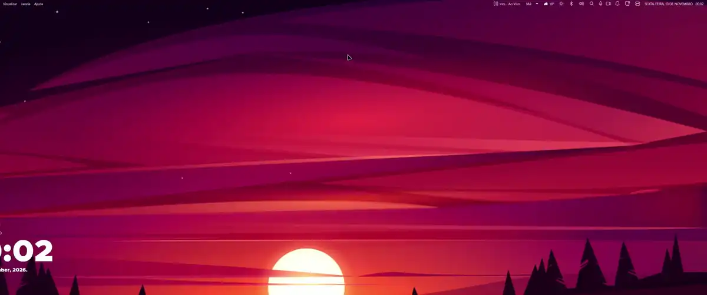
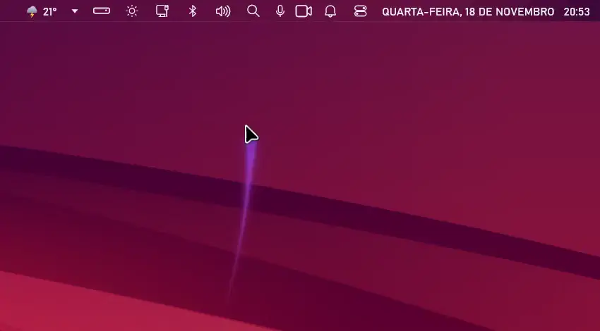

# Mac OS 27 Finder Bar

**English** | [Português](README.pt-BR.md)

A [Windhawk](https://windhawk.net) mod that adds a macOS 27-style menu bar to the top of the screen in Windows 11: the menus of the app in front on the left, and system status, Control Center, notifications and the clock on the right, all in live glass.

[Watch in full quality (MP4)](screenshots/demo.mp4)

---

## New in 1.1.1

[Watch in full quality (MP4)](screenshots/notifications-stack.mp4)

- **Stacked notifications**: with three apps or more, the floating notifications are stacked, the newest in front. Turn the mouse wheel to bring the next one to the front, drag the front card aside to dismiss it, or click to spread the cards into the list with a spring animation; **Show less** stacks them again
- **Android-style scrolling**: the open list scrolls smoothly with the wheel or by dragging, and the cards pile up at the edges instead of being cut off
- **Red bell**: the bell turns red when a notification arrives, like the microphone and camera icons
- **Notifications and pills apart**: *Receive app notifications* and *Show notice pills* are separate switches; with the pills off, notifications still go to the bell
- **Selection gradient**: the selection pill can blend two colors
- **Test notifications**: a button in the settings sends a test notification from a different app on each click

---

## Highlights

- **Global menu**: the menus of the app in front, on the bar. Classic Win32 apps show their real menus; modern apps show their menu bar through UI Automation when they have one; browsers, File Explorer, Office, VS Code and other apps get ready-made menus that send the app's own shortcuts. A **Window** menu lists the app's open windows, and **Help** searches every menu of the app
- **Logo menu**: About This PC, System Settings, Microsoft Store (with pending update counts), Force Quit, Sleep, Hibernate, Restart, Shut Down, Lock Screen and Sign Out
- **Status icons**: battery, Wi-Fi, Bluetooth, sound (scroll to change the volume), display, keyboard layout, Now Playing (the song name scrolls when it doesn't fit; a thin round play or pause icon on the bar; large-cover, compact or full-cover panel (the cover fills it, with glass buttons on top, white ones in light glass themes) with a progress bar drawn as a line, a colored line or a wave), Focus, microphone and camera (the icons turn orange and green while in use, click to see which apps use them and mute the microphone), weather and search (Windows Search or Siri Plus Launchpad); icons that don't fit collapse into an arrow, and each icon can be turned on or off
- **Control Center**: Wi-Fi, Bluetooth, media, dark mode, Do Not Disturb, brightness, sound and output, plus tiles you can add: night light, airplane mode, screenshot, screen recording, power mode and power plan, energy saver (one click on and off), magnifier, lock screen, calculator, Task Manager, emoji and show desktop. **Edit Controls** adds, removes, moves and resizes tiles. Power mode opens a box with the Windows 11 modes and power plans (repeated plans hidden). Tile names that don't fit scroll when the mouse is over the tile. Tiles can be pills or rounded squares
- **Notice pills**: glass pills that drop from the bar for headphones, audio output, low battery, charger, Focus, Caps Lock, USB devices and drives, finished downloads, copy and cut, screenshots, screen recordings and Windows notifications (the ones you can act on stay longer and go to the bell panel), plus floating pills for volume, brightness and Bluetooth. Style (the bar's background, glass, liquid glass, custom liquid glass, light, dark or OLED), text color, live background, size, position, duration and animations are configurable
- **Notifications** (turn on *Receive app notifications* in **Menu Bar Settings…** → **Notice pills** → **Notifications button**): app notifications go to the bell panel, grouped by app, and also to a pill when notice pills are on; **reply** to messages (like WhatsApp) right from the pill or the panel's Reply button when the app supports it, and your replies stay in the card; new messages from the same conversation go into the same card; **drag** a notification aside to clear it; the panel is **Floating** (default: the top and each notification in its own glass card; with three apps or more, a stack you turn with the wheel) or **Inside the box**; optionally, with notice pills on, **only the bar** shows notifications (Windows' banners move off the screen while the bar shows them)
- **Calendar**: click the clock for the calendar and your agenda from your own .ics files (read locally, never downloaded), imported right from the settings
- **Weather**: the temperature on the bar and a glass widget with the forecast (Open-Meteo, MET Norway or wttr.in, no account needed); the widget is colored, liquid glass or plain glass, and its animations can be turned off
- **Themes**: transparent (default), glass, liquid glass, custom liquid glass, "Window color" (transparent over the desktop, the color of the title bar of the maximized window on that display) or solid light, dark and OLED. The bar's theme also styles the menus, the Control Center, the panels and the pills; **Panel theme** can give the menus their own. One theme for every display, or **Customize per display** for a background and text color on each one
- **Customize theme**: each glass theme keeps its own settings (transparent ↔ frosted, edge refraction and background blur for the liquid ones, and **Live**, which keeps videos and animated wallpapers moving behind the glass), with **Restore defaults** for that theme. **Custom liquid glass** (the theme from Siri Plus Launchpad): your color at the top, fading to clear glass at the bottom, with a fine line of light along the bottom edge
- **Bar**: nine selection colors, or a gradient of two (one for the bar, the menus and their switches), the font, the bar height and one size for icons and text; hides with full-screen apps; optionally hides while a window is maximized (and comes back by itself on the desktop), or stays hidden until you click a thin handle at the top center; every monitor or the one you choose
- **Disks** (optional): the menu lists every local and removable disk with a usage bar and opens it in Explorer; clicking the album cover opens the playing app
- **Settings window**: logo → **Menu Bar Settings…** opens the settings in a macOS-style window, with search, applied live without restarting the bar
- **Your language**: follows the Windows display language, or pick one (English, Portuguese, Spanish, French, German, Italian and Simplified Chinese)

---

## Installing

1. Install [Windhawk](https://windhawk.net).
2. Search for **Mac OS 27 Finder Bar** in Windhawk's mod catalog and click **Install**.

To try a version from this repository before it reaches the catalog: in Windhawk, click **Create a new mod**, replace the code with the contents of [`mac-os-27-finder-bar.wh.cpp`](mac-os-27-finder-bar.wh.cpp), and click **Compile Mod** and then **Exit Editing Mode**.

## Settings

The settings live in the mod's own window: logo menu → **Menu Bar Settings…**, applied live. Windhawk's settings page for the mod has the few the window doesn't: glass tints, theme, the name shown for the desktop, ready-made menus, Control Center tile look, opening animation, tray click, the app update count and .ics file paths, plus **Reset the bar's settings**, which puts the window's options back to their defaults if the bar ever doesn't show up.

## What changes Windows settings

Some Control Center tiles and menu items change real Windows settings, the same ones Windows' own quick settings change, and they stay changed after the mod is turned off: dark mode (app and system theme, both set to the same value), night light, power mode and power plan (a power mode also switches the plan to Balanced), energy saver, Do Not Disturb, brightness, default audio device, volume and mute, microphone mute, Wi-Fi and Bluetooth radios, Wi-Fi network and display mode; a device paired from the bar's Bluetooth pill stays paired, as if paired in Settings. Nothing changes unless you click the matching tile or item.

While the bar's volume and brightness indicator is on, Windows' own volume pill is kept hidden so only one shows (the older pill is minimized; the newer one, which the keyboard volume keys show on recent Windows 11 versions, is cloaked by the mod's part inside Explorer, or moved off the screen if that fails). It may still show once, the first time the volume changes after Explorer starts. Turning the indicator or the mod off brings it back; if the bar's process ever crashes, it comes back when Explorer restarts.

## Network use

The mod only goes online for features you set up yourself (the calendar reads local .ics files only):

- **Weather**, once you pick a place: place search through OpenStreetMap Nominatim or Open-Meteo, and the forecast from the service you choose (Open-Meteo, MET Norway or wttr.in) with the place's coordinates rounded to about 1 km. Turning the weather icon off stops all requests.
- **App update count** (off by default, in Windhawk's settings): runs `winget upgrade`, which checks winget's sources online. The mod never accepts winget's source agreements for you. The Windows Update count is offline.

The copy pill only says "Copied" or "Cut": it never shows what was copied, and it skips anything an app marks as private (password managers do), the same way Windows' clipboard history does.

## How it runs

The bar runs in its own Windhawk process (shown as Windhawk in Task Manager), so if it ever fails, the taskbar and desktop keep working. Explorer keeps only a small hook that copies the tray icons' registrations to the bar. If that process is ended by hand, turn the mod off and on again in Windhawk to bring the bar back.

## Known limitations

- Apps without a classic menu bar use ready-made menus based on keyboard shortcuts.
- Bluetooth lists the connected classic (non-BLE) devices; connecting and disconnecting a paired device opens Settings. New devices can be found and paired in the bar's Bluetooth pill (the pairing code shows in the pill, to confirm or to type on the device), except devices that ask you to type a PIN on the PC, which need Settings.
- Power mode and energy saver use undocumented Windows functions; if Windows refuses, the tile opens the matching Settings page.
- Screen recording uses Win+Shift+R and needs an up-to-date Snipping Tool.
- Replying from the pill works with apps that register a notification activator with Windows; otherwise the pill opens the app and copies your text.
- With live glass, the bar's liquid backgrounds and the Glass background without "live", the bar (and, with live glass, the panels) doesn't show up in screenshots.
- If Windhawk itself runs as administrator (portable mode started elevated), the bar doesn't show the tray icons: letting the shell's tray data reach an elevated bar would also let any app send it fake icons.

## License

[GPL-3.0](LICENSE)
