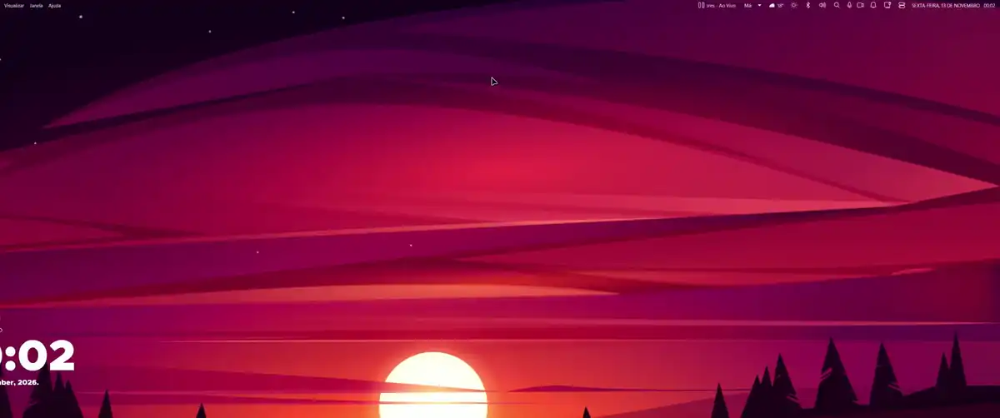
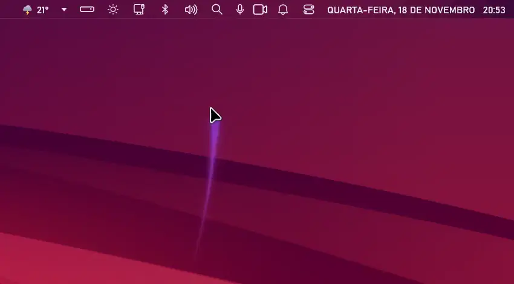

# Mac OS 27 Finder Bar

[English](README.md) | **Português**

Um mod do [Windhawk](https://windhawk.net) que coloca uma barra de menus no estilo do macOS 27 no topo da tela do Windows 11: à esquerda, os menus do app em primeiro plano; à direita, o estado do sistema, a Central de Controle, as notificações e o relógio, tudo em vidro ao vivo.

[Assistir em qualidade máxima (MP4)](screenshots/demo.mp4)

---

## Novidades da 1.1.1

[Assistir em qualidade máxima (MP4)](screenshots/notifications-stack.mp4)

- **Notificações empilhadas**: com três apps ou mais, as notificações flutuantes ficam em pilha, a mais nova na frente. Gire a roda do mouse para trazer a próxima para a frente, arraste o cartão da frente para o lado para dispensá-lo, ou clique para abrir os cartões na lista com uma animação de mola; **Mostrar menos** empilha de novo
- **Rolagem como no Android**: a lista aberta rola suave, pela roda ou arrastando, e os cartões se amontoam nas bordas em vez de serem cortados
- **Sino vermelho**: o sino fica vermelho quando chega uma notificação, como os ícones do microfone e da câmera
- **Notificações e pílulas separadas**: *Receber as notificações dos apps* e *Mostrar avisos em pílula* são interruptores independentes; com as pílulas desligadas, as notificações continuam indo para o sino
- **Seleção em degradê**: a pílula de seleção pode misturar duas cores
- **Testar notificações**: um botão nos ajustes manda uma notificação de teste de um app diferente a cada clique
- **Limpar com animação**: os cartões saem um depois do outro
- **A barra desliza** para cima e para baixo ao sumir e aparecer; com "Ocultar com janela maximizada", encostar o mouse no topo a mostra por cima da janela, como no macOS
- **Cópia dos ajustes**: exporte para um arquivo e importe depois ou em outro PC
- **Num Lock e Scroll Lock** com pílula, como o Caps Lock
- **Caixa de vidro** para confirmar Reiniciar, Desligar e Encerrar sessão
- **Capa do Tocando Agora mais nítida**: a capa é ampliada uma vez em alta qualidade, e a miniatura de vídeo aparece inteira sobre uma cópia desfocada dela mesma, em vez de um recorte do meio esticado
- **Correções**: a barra sumindo ou recarregando com o mouse parado num botão (vários monitores com escalas diferentes), a pílula acompanhando a barra no Vidro, a barra voltando depois da tela cheia com a alça ligada, o nome do app depois de minimizar ou fechar, os menus fazendo a janela do app piscar, a barra por cima de vídeo em tela cheia no outro monitor, atualizações opcionais contadas como pendentes, os ícones do próprio Windows na bandeja, miniaturas de vídeo esticadas, aparelhos Bluetooth LE (mouses, teclados) fora da lista e "Ajustes do Sistema" em português

---

## Destaques

- **Menu global**: os menus do app em primeiro plano, na barra. Apps Win32 clássicos mostram os menus de verdade; apps modernos mostram a barra de menus deles por UI Automation quando existe; navegadores, Explorador de Arquivos, Office, VS Code e outros ganham menus prontos que mandam os atalhos do próprio app. O menu **Janela** lista as janelas abertas do app, e a **Ajuda** busca em todos os menus dele
- **Menu do logo**: Sobre este PC, Ajustes do Sistema, Microsoft Store (com o número de atualizações pendentes), Forçar encerramento, Suspender, Hibernar, Reiniciar, Desligar, Bloquear tela e Encerrar sessão
- **Ícones de estado**: bateria, Wi-Fi, Bluetooth, som (role sobre o ícone para mudar o volume), tela, layout de teclado, Tocando agora (o nome da música passa quando não cabe; na barra, um ícone redondo e fino de play ou pausa; painel com capa grande, compacto ou capa inteira (a capa ocupa o painel, com botões de vidro por cima, brancos nos temas de vidro claros) e barra de progresso em linha, linha colorida ou onda), Foco, microfone e câmera (os ícones ficam laranja e verde quando em uso; clique para ver quais apps estão usando e silenciar o microfone), previsão do tempo e busca (Pesquisa do Windows ou Siri Plus Launchpad); os ícones que não cabem se recolhem numa seta, e cada ícone pode ser ligado ou desligado
- **Central de Controle**: Wi-Fi, Bluetooth, mídia, modo escuro, Não Perturbe, brilho, som e saída de áudio, e blocos que você pode adicionar: luz noturna, modo avião, captura de tela, gravação de tela, modo e plano de energia, economia de energia (liga e desliga com um clique), lupa, bloquear tela, calculadora, Gerenciador de Tarefas, emojis e mostrar área de trabalho. **Editar controles** adiciona, remove, move e redimensiona os blocos. O modo de energia abre uma caixa com os modos do Windows 11 e os planos de energia (planos repetidos ficam ocultos). Os nomes dos blocos que não cabem passam ao parar o mouse em cima. Os blocos podem ser pílulas ou quadrados arredondados
- **Pílulas de aviso**: pílulas de vidro que descem da barra para fones, saída de áudio, bateria fraca, carregador, Foco, Caps Lock, dispositivos USB e discos, downloads concluídos, copiar e recortar, capturas e gravações de tela e notificações do Windows (as que permitem uma ação ficam mais tempo e vão para o painel do sino), além de pílulas flutuantes de volume, brilho e Bluetooth. Estilo (o fundo da barra, vidro, vidro líquido, vidro líquido personalizado, claro, escuro ou OLED), cor do texto, fundo ao vivo, tamanho, posição, duração e animações são ajustáveis
- **Notificações** (ligue *Receber as notificações dos apps* em **Ajustes da Barra de Menus…** → **Pílulas de aviso** → **Botão de Notificações**): as notificações dos apps vão para o painel do sino, agrupadas por app, e também para a pílula quando as pílulas estão ligadas; **responda** mensagens (como do WhatsApp) direto pela pílula ou pelo botão Responder do painel quando o app permite, e as suas respostas ficam no cartão; mensagens novas da mesma conversa entram no mesmo cartão; **arraste** uma notificação para o lado para apagá-la; o painel é **Flutuante** (padrão: o topo e cada notificação no seu próprio cartão de vidro; com três apps ou mais, uma pilha que gira com a roda) ou **Dentro da caixa**; e, se quiser, com as pílulas ligadas, **só a barra** mostra as notificações (as faixas do Windows saem da tela enquanto a barra as mostra)
- **Calendário**: clique no relógio para ver o calendário e a sua agenda, de arquivos .ics seus (lidos no PC, nunca baixados), importados direto pelos ajustes
- **Previsão do tempo**: a temperatura na barra e um widget de vidro com a previsão (Open-Meteo, MET Norway ou wttr.in, sem precisar de conta); o widget pode ser colorido, de vidro líquido ou de vidro, e as animações podem ser desligadas
- **Temas**: transparente (padrão), vidro, vidro líquido, vidro líquido personalizado, "Cor da janela" (transparente na área de trabalho, com a cor da barra de título da janela maximizada naquele monitor) ou sólidos claro, escuro e OLED. O tema da barra vale também para os menus, a Central de Controle, os painéis e as pílulas; **Tema dos painéis** dá aos menus um tema próprio. Um tema para todos os monitores, ou **Personalizar por monitor** para dar a cada um fundo e cor do texto próprios
- **Personalizar tema**: cada tema de vidro guarda os seus ajustes (transparente ↔ fosco, refração nas bordas e desfoque do fundo nos líquidos, e **Ao vivo**, que mantém vídeos e papéis de parede animados se mexendo atrás do vidro), com **Restaurar o padrão** do tema. **Vidro líquido personalizado** (o tema do Siri Plus Launchpad): a sua cor no topo, sumindo em vidro limpo embaixo, com uma linha fina de luz na borda de baixo
- **Barra**: nove cores de seleção, ou um degradê de duas (uma para a barra, os menus e os interruptores deles), a fonte, a altura da barra e um tamanho só para ícones e texto; some com apps em tela cheia; pode se ocultar enquanto uma janela está maximizada (e volta sozinha na área de trabalho), ou ficar oculta até um clique numa alça fina no centro do topo; todos os monitores ou o que você escolher
- **Discos** (opcional): o menu lista os discos locais e removíveis com uma barra de uso e abre cada um no Explorador; clicar na capa do álbum abre o app que está tocando
- **Janela de ajustes**: logo → **Ajustes da Barra de Menus…** abre os ajustes numa janela no estilo do macOS, com busca, aplicados na hora, sem reiniciar a barra
- **O seu idioma**: segue o idioma do Windows, ou escolha um (inglês, português, espanhol, francês, alemão, italiano e chinês simplificado)

---

## Instalação

1. Instale o [Windhawk](https://windhawk.net).
2. Procure **Mac OS 27 Finder Bar** no catálogo de mods do Windhawk e clique em **Install**.

Para testar uma versão deste repositório antes de ela chegar ao catálogo: no Windhawk, clique em **Create a new mod**, troque o código pelo conteúdo de [`mac-os-27-finder-bar.wh.cpp`](mac-os-27-finder-bar.wh.cpp) e clique em **Compile Mod** e depois em **Exit Editing Mode**.

## Ajustes

Os ajustes ficam na janela do próprio mod: menu do logo → **Ajustes da Barra de Menus…**, aplicados na hora. A página de configurações do mod no Windhawk tem só os poucos que a janela não tem: tintas do vidro, tema, nome exibido para a área de trabalho, menus prontos, aparência dos blocos da Central, animação de abertura, clique na bandeja, contagem de atualizações de apps e caminhos de arquivos .ics, além de **Restaurar os ajustes da barra**, que volta as opções da janela ao padrão se a barra um dia não aparecer.

## O que muda ajustes do Windows

Alguns blocos da Central de Controle e itens de menu mudam ajustes reais do Windows, os mesmos que as configurações rápidas do próprio Windows mudam, e eles continuam mudados depois que o mod é desligado: modo escuro (tema dos apps e do sistema, os dois com o mesmo valor), luz noturna, modo e plano de energia (um modo de energia também passa o plano para Equilibrado), economia de energia, Não Perturbe, brilho, saída de áudio padrão, volume e mudo, microfone silenciado, rádios de Wi-Fi e Bluetooth, rede Wi-Fi e modo de projeção; um aparelho pareado pela pílula do Bluetooth da barra continua pareado, como se fosse pareado nas Configurações. Nada muda sem você clicar no bloco ou item.

Enquanto o indicador de volume e brilho da barra está ligado, a pílula de volume do próprio Windows fica escondida, para aparecer só uma (a antiga é minimizada; a nova, que as teclas de volume mostram nas versões recentes do Windows 11, é encoberta pela parte do mod que roda no Explorer, ou sai da tela se isso falhar). Ela ainda pode aparecer uma vez, na primeira mudança de volume depois que o Explorer abre. Desligar o indicador ou o mod a traz de volta; se o processo da barra travar e fechar, ela volta quando o Explorer reiniciar.

## Uso da rede

O mod só acessa a internet para recursos que você mesmo configura (o calendário só lê arquivos .ics do PC):

- **Previsão do tempo**, depois que você escolhe um lugar: a busca do lugar pelo OpenStreetMap Nominatim ou pelo Open-Meteo, e a previsão pelo serviço que você escolher (Open-Meteo, MET Norway ou wttr.in), com as coordenadas do lugar arredondadas para cerca de 1 km. Desligar o ícone da previsão para todos os pedidos.
- **Contagem de atualizações de apps** (desligada por padrão, nas configurações do Windhawk): roda `winget upgrade`, que consulta as fontes do winget pela internet. O mod nunca aceita os termos das fontes do winget por você. A contagem do Windows Update é offline.

A pílula de copiar só diz "Copiado" ou "Recortado": nunca mostra o que foi copiado, e ignora o que um app marca como privado (os gerenciadores de senha fazem isso), do mesmo jeito que o histórico da área de transferência do Windows.

## Como funciona

A barra roda num processo próprio do Windhawk (aparece como Windhawk no Gerenciador de Tarefas): se ela falhar, a barra de tarefas e a área de trabalho continuam funcionando. No Explorer fica só um gancho pequeno, que copia os registros dos ícones da bandeja para a barra. Se esse processo for encerrado à mão, desative e reative o mod no Windhawk para a barra voltar.

## Limitações conhecidas

- Apps sem barra de menus clássica usam menus prontos baseados em atalhos de teclado.
- O Bluetooth lista os aparelhos clássicos (não BLE) conectados; conectar e desconectar um aparelho já pareado abre as Configurações. Aparelhos novos podem ser encontrados e pareados na pílula do Bluetooth da barra (o código do pareamento aparece na pílula, para confirmar ou digitar no aparelho), menos os que pedem para digitar um PIN no PC, que precisam das Configurações.
- O modo de energia e a economia de energia usam funções não documentadas do Windows; se o Windows recusar, o bloco abre a página certa das Configurações.
- A gravação de tela usa Win+Shift+R e precisa da Ferramenta de Captura atualizada.
- Responder pela pílula funciona com apps que registram um ativador de notificações no Windows; senão, a pílula abre o app e copia o seu texto.
- Com o vidro ao vivo, os fundos líquidos da barra e o fundo Vidro sem "ao vivo", a barra (e, com o vidro ao vivo, os painéis) não aparece em capturas de tela.
- Se o próprio Windhawk rodar como administrador (modo portátil aberto elevado), a barra não mostra os ícones da bandeja: deixar os dados da bandeja do shell chegarem a uma barra elevada também deixaria qualquer app mandar ícones falsos para ela.

## Licença

[GPL-3.0](LICENSE)
