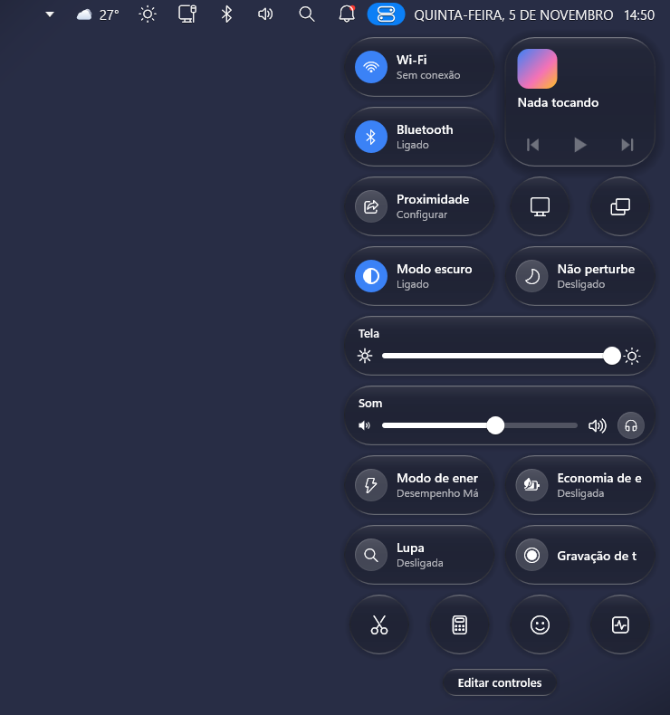
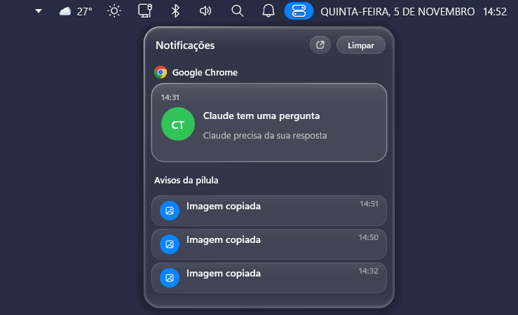
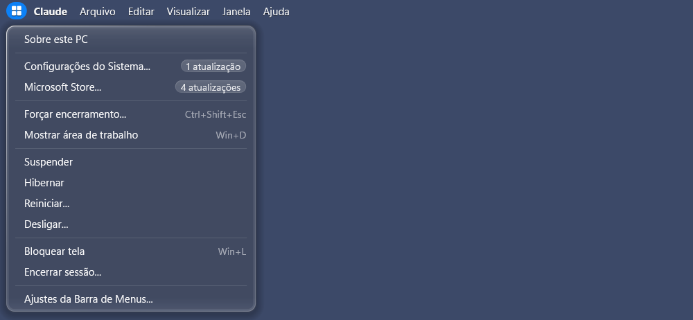
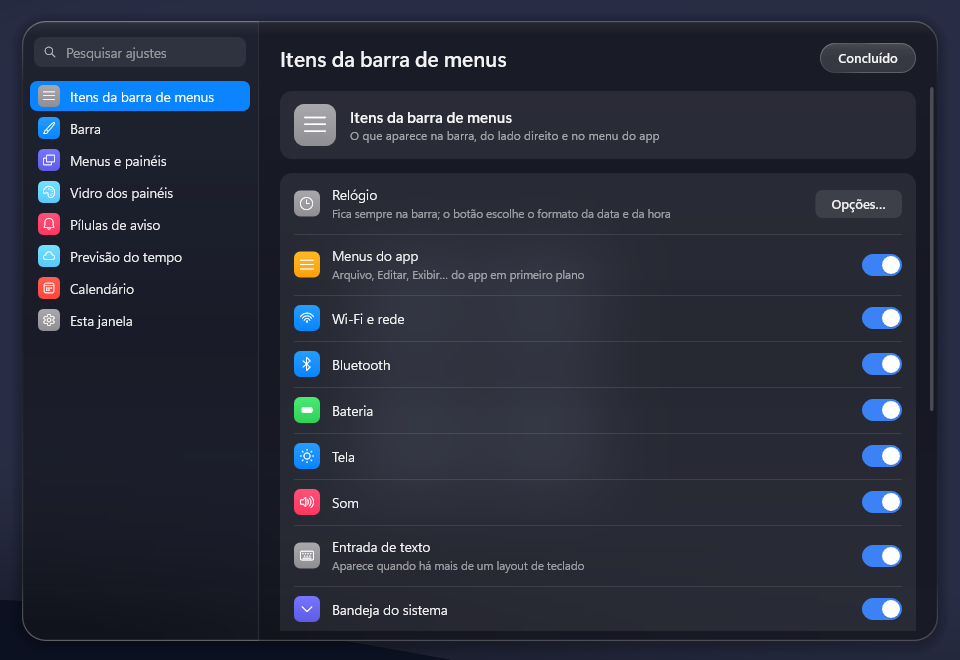

# Mac OS 27 Finder Bar

[English](README.md) | **Português**

Um mod do [Windhawk](https://windhawk.net) que coloca uma barra de menus no estilo do macOS 27 no topo da tela do Windows 11: à esquerda, os menus do app em primeiro plano; à direita, o estado do sistema, a Central de Controle, as notificações e o relógio, tudo em vidro ao vivo.

| Central de Controle | Notificações |
|---|---|
|  |  |

| Menu do logo | Janela de ajustes |
|---|---|
|  |  |

---

## Destaques

- **Menu global**: os menus do app em primeiro plano, na barra. Apps Win32 clássicos mostram os menus de verdade; apps modernos mostram a barra de menus deles por UI Automation quando existe; navegadores, Explorador de Arquivos, Office, VS Code e outros ganham menus prontos que mandam os atalhos do próprio app. O menu **Janela** lista as janelas abertas do app, e a **Ajuda** busca em todos os menus dele
- **Menu do logo**: Sobre este PC, Configurações do Sistema, Microsoft Store (com o número de atualizações pendentes), Forçar encerramento, Suspender, Hibernar, Reiniciar, Desligar, Bloquear tela e Encerrar sessão
- **Ícones de estado**: bateria, Wi-Fi, Bluetooth, som (role sobre o ícone para mudar o volume), tela, layout de teclado, Tocando agora (o nome da música passa quando não cabe; painel com capa grande ou compacto e barra de progresso em linha, linha colorida ou onda), Foco, pontos de privacidade do microfone e da câmera, previsão do tempo e busca (Pesquisa do Windows ou Siri Plus Launchpad); os ícones que não cabem se recolhem numa seta, e cada ícone pode ser ligado ou desligado
- **Central de Controle**: Wi-Fi, Bluetooth, mídia, modo escuro, Não Perturbe, brilho, som e saída de áudio, e blocos que você pode adicionar: luz noturna, modo avião, captura de tela, gravação de tela, modo e plano de energia, economia de energia (liga e desliga com um clique), lupa, bloquear tela, calculadora, Gerenciador de Tarefas, emojis e mostrar área de trabalho. **Editar controles** adiciona, remove, move e redimensiona os blocos. O modo de energia abre uma caixa com os modos do Windows 11 e os planos de energia (planos repetidos ficam ocultos). Os nomes dos blocos que não cabem passam ao parar o mouse em cima. Os blocos podem ser pílulas ou quadrados arredondados
- **Pílulas de aviso**: pílulas de vidro que descem da barra para fones, saída de áudio, bateria fraca, carregador, Foco, dispositivos USB e discos, downloads concluídos, itens copiados, capturas de tela e notificações do Windows, além de pílulas flutuantes de volume, brilho e Bluetooth. Estilo (vidro, vidro líquido ou escuro), tamanho, posição, duração e animações são ajustáveis
- **Notificações** (ligue *Notificações do Windows* nos ajustes das pílulas): as notificações dos apps aparecem na pílula e no painel do sino, agrupadas por app; **responda** mensagens (como do WhatsApp) direto pela pílula quando o app permite; **arraste** uma notificação para o lado para apagá-la; e, se quiser, **só a barra** mostra as notificações (as faixas do Windows saem da tela enquanto a barra as mostra)
- **Calendário**: clique no relógio para ver o calendário e a sua agenda, de arquivos ou links .ics, importados direto pelos ajustes
- **Previsão do tempo**: a temperatura na barra e um widget de vidro com a previsão (Open-Meteo, MET Norway ou wttr.in, sem precisar de conta)
- **Vidro ao vivo**: a barra e os painéis desfocam o que está atrás deles em tempo real, com um vidro líquido experimental com refração nas bordas (ligado por padrão)
- **Barra e menus**: barra transparente (padrão), de vidro desfocado ou de vidro líquido, opaca com o app maximizado; menus com vidro fosco próprio ou o mesmo vidro da Central; tema claro, escuro ou automático, nove cores de seleção, fonte e tamanhos; some com apps em tela cheia, ocultar automaticamente opcional, todos os monitores
- **Janela de ajustes**: logo → **Ajustes da Barra de Menus…** abre todos os ajustes numa janela no estilo do macOS, com busca, aplicados na hora, sem reiniciar a barra
- **O seu idioma**: segue o idioma do Windows, ou escolha um (inglês, português, espanhol, francês, alemão, italiano e chinês simplificado)

---

## Instalação

1. Instale o [Windhawk](https://windhawk.net).
2. Procure **Mac OS 27 Finder Bar** no catálogo de mods do Windhawk e clique em **Install**.

Para testar uma versão deste repositório antes de ela chegar ao catálogo: no Windhawk, clique em **Create a new mod**, troque o código pelo conteúdo de [`mac-os-27-finder-bar.wh.cpp`](mac-os-27-finder-bar.wh.cpp) e clique em **Compile Mod** e depois em **Exit Editing Mode**.

## Ajustes

Quase todos os ajustes ficam na janela do próprio mod: menu do logo → **Ajustes da Barra de Menus…**. A página de configurações do mod no Windhawk tem as mesmas opções, além dos links .ics de calendário.

## Limitações conhecidas

- Apps sem barra de menus clássica usam menus prontos baseados em atalhos de teclado.
- O Bluetooth lista os aparelhos clássicos (não BLE) e abre as Configurações para conectar e desconectar.
- O modo de energia e a economia de energia usam funções não documentadas do Windows; se o Windows recusar, o bloco abre a página certa das Configurações.
- A gravação de tela usa Win+Shift+R e precisa da Ferramenta de Captura atualizada.
- Responder pela pílula funciona com apps que registram um ativador de notificações no Windows; senão, a pílula abre o app e copia o seu texto.
- Com o vidro ao vivo (e o fundo líquido da barra), a barra e os painéis não aparecem em capturas de tela.

## Licença

[GPL-3.0](LICENSE)
